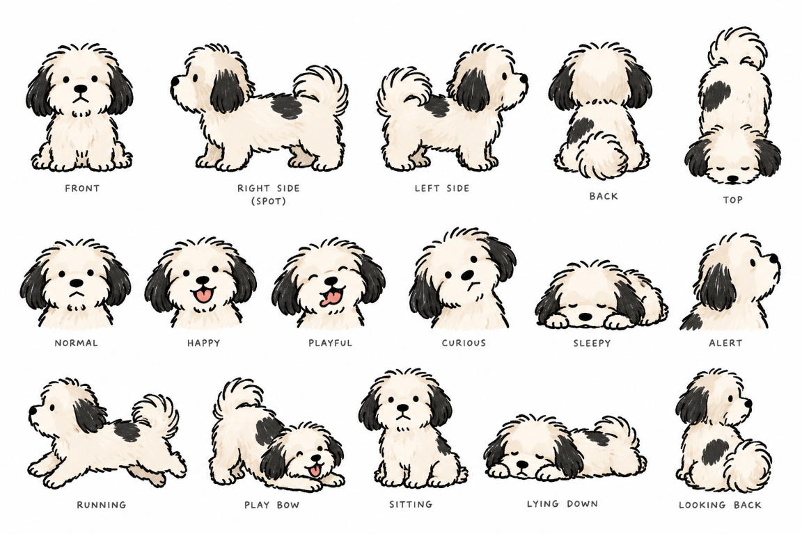

# Chopper

Chopper was your dog, your good boy. On the Loushing site he lives on in small,
hand-drawn cameos at the edges of pages: napping on the footer, barking at the robot
vacuum, sniffing a parcel, chasing birds. He never has anything to do with the content.
He is a quiet companion you can ignore, and he never gets in the way.

> **TL;DR.**
> - **Who he is:** a small, fluffy cream dog with long black ears and a black saddle
>   patch, drawn in a sketchy ink style. The [character sheet](#the-character-sheet)
>   is the single reference for every image.
> - **His world:** home life. His toys, the couch, the parcel box, the indoor plant,
>   the balcony, the evening walk, and a small supporting cast (a squirrel, pigeons,
>   sparrows, a butterfly and the robot vacuum). At most 2 props per image.
> - **Moments and stories:** a moment is one image, or a set piece of 2 images placed
>   together, such as a squirrel on one side and Chopper sniffing toward it on the
>   other. Moments follow short stories that carry on from page to page, so every
>   page view, including a reload, shows something new.
> - **Never in the way:** at most 2 moments per page and 1 per screen, never over
>   content or controls, no layout shift, invisible to screen readers, no looping
>   motion, lazy-loaded, and a "Hide Chopper" setting.
> - **Drawn for its size:** each image is drawn for the size it is shown at, with one
>   line width across every image. Never a big image shrunk into a small spot; the
>   only reduction is one uniform factor applied to every image.
> - **Now:** 46 scenes, 4 set pieces and 13 stories planned, in 89 renders. 0
>   approved. About $10 for the full library; a 4-render pilot (about $0.40) comes
>   first, with your go-ahead.
> - **Open:** the tribute wording ([O26](#decisions-on-this-page)) and whether he
>   appears in the logo or favicon (O32).

Related pages: [design system](design-system.md) · [visual first](visual-first.md) ·
[Definitions of Done](../spec/definition-of-done.md).

## In his memory

Loushing carries one line about him, in the footer of every page, beside the "Hide
Chopper" setting. It is the only place the site's words mention him. Its wording is
yours to write ([O26](#decisions-on-this-page)); until then the draft is:

> Chopper, a very good boy, keeps us company here.

He is drawn doing what he did: napping, playing, watching, being a dog at home. Never
sad, hurt, scared or dressed up, and never used to sell anything.

## The character sheet

<figure class="slate-figure">
  
  <figcaption>The canonical reference, kept at design/chopper/reference/character-sheet.png. Every generated image passes it to the model.</figcaption>
</figure>

## Who he is

| Feature | On the sheet | Never |
| --- | --- | --- |
| Coat | Cream and ivory, fluffy, with warm beige shading | Pure white, grey, or other colours |
| Ears | Long, feathery, solid black, floppy | Cream ears, pointed ears |
| Saddle patch | Black, on his back: larger and mid-back on his right side, smaller and near the shoulder on his left | Missing, moved, or mirrored |
| Face | Round black bead eyes, a small black nose, a tufty fringe | Big cartoon eyes, eyebrows, human expressions |
| Tongue | Coral, showing when happy or playful | Any other colour |
| Tail | Plumed, curled over his back | Straight or docked |
| Size and build | Small, round and fluffy; an adult dog | A puppy, or another breed |

**Moods** come from the sheet: normal, happy, playful, curious, sleepy and alert.
**Facings** are front, left, right and back. Because his markings differ on each side,
an image is never mirrored; a scene facing the other way is generated as its own image.

## Art style

A loose, sketchy, hand-drawn ink line, slightly uneven, with flat soft fill and very
light shading, exactly as on the sheet. No 3D, gradients, photo textures, outlines or
glows. Each image is isolated on a true transparent background with no backdrop,
frame or text, and no ground except a sun patch where a scene calls for one.

Props and the supporting cast are drawn in the same ink line, at true scale to him,
in muted colours. He is the only hand-drawn thing in the interface, so the contrast
between his line and the crisp system is what makes him read as a character.

## His world

His scenes come from ordinary home life: the couch, the parcel that just arrived, the
plant he is not supposed to sniff, the balcony, his bowl, his toys and the evening
walk. Things he did, in places he knew.

  <article class="slate-card">
    
Toys

    <h3 class="slate-card__title">4</h3>
    
The coral ball (his favourite, the same ball everywhere), a squeaky bone, a squeaky duck, a rope tug toy.

  </article>
  <article class="slate-card">
    
Around the home

    <h3 class="slate-card__title">11</h3>
    
Couch, parcel box, indoor plant, balcony rail, food and water bowls, leash, cushion, blanket, slipper, striped sock.

  </article>
  <article class="slate-card">
    
Outdoors

    <h3 class="slate-card__title">5</h3>
    
A stick, a falling leaf, an acorn, sparrows taking off, a butterfly.

  </article>
  <article class="slate-card">
    
Effects

    <h3 class="slate-card__title">4</h3>
    
Water droplets, soap bubbles, clumps of earth, a sun patch.

  </article>

**Props.** At most 2 in one image. Each is described once in `scenes.json`, so the
ball, the box or the couch looks the same in every scene. Larger household things are
cut off cleanly where they leave the frame (one end of the couch, a short length of
railing). No brands, logos, labels or writing (the parcel has none), no screens, and
nothing unsafe for a dog.

### The supporting cast

| Cast | Who | Appears |
| --- | --- | --- |
| Squirrel | Small, grey-brown, bushy tail; quick, cheeky and never caught | Set pieces with him |
| Pigeons | Two plump grey pigeons, calm and entirely unbothered by him | On the balcony rail, in set pieces |
| Sparrows | Small and brown, always flying off | As a prop when he chases them |
| Butterfly | Small, pale yellow, about the size of his ear | As a prop, or in set pieces |
| Robot vacuum | Round, low and grey, with one small light; it never touches him | In set pieces |

Each cast member gets its own small character sheet in his style. You approve it
before any scene uses it, and it is passed as a reference with his. The cast is never
larger than he is, never appears without him, and is never caught, hurt or
threatening. He barks boldly, never fearfully, and every story ends well.

## Rules of presence

  <article class="slate-card">
    <h3 class="slate-card__title">Never the point</h3>
    
Small, at the edges, unrelated to the content. Never in a hero, a loading state or a message's place.

  </article>
  <article class="slate-card">
    <h3 class="slate-card__title">Never in the way</h3>
    
Never over text, controls or focus rings. Reserved space or out of flow, so nothing shifts. No pointer events.

  </article>
  <article class="slate-card">
    <h3 class="slate-card__title">Invisible to assistive tech</h3>
    
Empty alt, hidden from screen readers, never focusable. Hidden in print and forced colours.

  </article>
  <article class="slate-card">
    <h3 class="slate-card__title">Quiet</h3>
    
At most one gentle settle as a moment comes into view; none with reduced motion. Nothing loops. He never speaks.

  </article>
  <article class="slate-card">
    <h3 class="slate-card__title">Light</h3>
    
Loaded after the page is idle, never the largest paint, at most 3 images and 90 KB a page. Without JavaScript he simply isn't there.

  </article>
  <article class="slate-card">
    <h3 class="slate-card__title">Optional</h3>
    
"Hide Chopper" in the footer hides him everywhere, and the choice is remembered on that device.

  </article>

## Where he appears

Layouts own cameo zones; view specs and content never place him. The zones, their
sizes and allowed poses are data in `design/chopper/scenes.json`. A zone reserves its
height; the image inside it always shows at its own drawn size
([drawn for its size](#drawn-for-its-size)).

| Zone | Where | Poses | Size | From width |
| --- | --- | --- | --- | --- |
| `footer-ledge` | Resting on the top edge of the footer | Lying, sitting, standing, playing | Small (56 px) | Any |
| `section-break` | Beside the divider between two sections | Running, standing, playing, lying, sitting | Small | Any |
| `list-end` | After the last result of a long list | Sitting, lying, standing | Medium (96 px) | Any |
| `empty-companion` | Beside an empty state, Not found or Gone; never over the message | Sitting, playing, lying, standing | Large (160 px) | Any |
| `masthead-edge` | The Home masthead's bottom edge, away from the search box | Peeking, lying | Small | md (56 rem) |
| `tile-peek` | Above a tile that is not interactive, such as a stat tile; only head and paws | Peeking | Small | md |
| `gutter` | The empty side gutters beside the content column | Sitting, standing, playing | Medium | xl (90 rem) |

| Layout | Zones |
| --- | --- |
| Landing (Home) | masthead-edge, tile-peek, section-break, gutter, footer-ledge |
| Index (Catalog, What's new) | list-end, empty-companion (no results), gutter, footer-ledge |
| Item (skill, kit, part) | section-break, gutter, footer-ledge |
| Path (stack) | section-break, gutter, footer-ledge |
| Article (Get started, For agents) | section-break, gutter, footer-ledge |
| Message (Not found, Gone) | empty-companion, footer-ledge |

**Never near:** the search box, the Get it panel, commands and code, banners and
warnings, form fields, or the component library's pages other than its scene gallery.

## Moments and set pieces

A **moment** is what appears in one place at one time: either one scene, or a
**set piece** of 2 separate images placed together. A set piece is the higher-order
joke the layout can tell with space: a squirrel sits at one end of the footer, and
at the other end Chopper sniffs his way toward it, unaware. The empty page between
them is the punchline.

  <article class="slate-card">
    
Footer or gutters

    <h3 class="slate-card__title">Squirrel standoff</h3>
    
Left: a squirrel sits up with an acorn. Right: Chopper sniffs his way toward it.

  </article>
  <article class="slate-card">
    
Footer, breaks or gutters

    <h3 class="slate-card__title">Vacuum patrol</h3>
    
Left: the robot vacuum glides along. Right: Chopper stands his ground and barks.

  </article>
  <article class="slate-card">
    
Breaks or gutters

    <h3 class="slate-card__title">Balcony pigeons</h3>
    
Left: two pigeons on the balcony rail, unbothered. Right: Chopper barks at them.

  </article>
  <article class="slate-card">
    
Breaks or gutters

    <h3 class="slate-card__title">Butterfly visit</h3>
    
Left: a butterfly drifts in. Right: Chopper watches it, head tilted.

  </article>

A set piece follows the rules of presence as one moment, plus these:

- **Same place, same screen.** Both parts go in the same zone, at its left and right
  ends, inside one screenful. If the zone or the width can't hold both (narrower than
  md, or a gutter on one side only), the set piece isn't a candidate.
- **Facing each other.** The left part faces right and the right part faces left.
  Because images are never mirrored, each part is drawn facing the way it is used.
- **One moment, two images.** It counts once toward the moments on a page and in a
  screen, and both images count toward the page's 3-image budget. Both settle in
  together, once.
- **Drawn as a pair.** Each part is its own image at the zone's size, under the same
  drawing standard, so the two read as one drawing across the gap.

## Stories

The site has a running story: a day in Chopper's life at home. It is told in short
threads of 2 to 4 beats; each beat is one moment.

<ol class="slate-steps">
  <li class="slate-step">
    
Morning

    
A slow morning: a big yawn, a stretch, waiting by his bowl, trotting off.

  </li>
  <li class="slate-step">
    
Day

    
A parcel came, the robot vacuum, pigeons on the balcony, the squirrel he never caught, a butterfly afternoon, a sunny afternoon.

  </li>
  <li class="slate-step">
    
Evening

    
The evening walk (leash, sniffing, chasing birds, a drink), and bath time.

  </li>
  <li class="slate-step">
    
Night

    
Lights out: an ear scratch, the couch, burrowed in his blanket.

  </li>
  <li class="slate-step">
    
Any time

    
Toy time, where did the ball go, and the sock heist.

  </li>
</ol>

- **On a page,** the two moments are consecutive beats, the earlier one higher up. The
  footer ledge usually gets the payoff: after the squirrel standoff near the top, he is
  asleep on his back at the bottom.
- **Across a visit,** the story carries on. Each page view shows the next beats; when a
  thread ends, the next page view starts another. Because his stories are unrelated to
  the content, any page can carry any beat.
- **By time of day,** threads favour the visitor's local time: morning stories in the
  morning, lights out at night. The time is read in the browser and never stored or
  sent. "Any time" stories fill the gaps ([O35](#decisions-on-this-page)).
- **Every story ends well.** Nothing is caught, lost for good, broken or scolded.

## Fresh on every visit

He is a background character, so variety keeps him a pleasant surprise instead of
wallpaper.

- **Every page view picks again,** including a reload. The pick happens in the
  browser when the page is shown, never at build time, so cached pages don't freeze
  him.
- **No quick repeats.** The last 8 moments in a visit are skipped while others fit.
- **A zone needs a choice before it turns on.** A zone shows him only once it has at
  least 4 approved moments at its size. Until then it stays empty, because an empty
  ledge is better than the same nap every time.
- **The library keeps growing.** New scenes, set pieces and threads are added a few at
  a time; each is data plus its images, with no code change.

## The scene library

  

    
46

    
Scenes

  

  

    
4

    
Set pieces

  

  

    
13

    
Stories

  

  

    
89

    
Renders planned, 0 approved

  

  <article class="slate-card">
    
12 scenes

    <h3 class="slate-card__title">Resting</h3>
    
Curled nap, belly-up nap, chin on paws, couch nap, sunbeam nap, nap in the parcel box, cushion nap, slipper nap, blanket burrow, roll-over, big yawn, morning stretch.

  </article>
  <article class="slate-card">
    
13 scenes

    <h3 class="slate-card__title">Playing</h3>
    
Tail chase, play bow with the ball, ball trot, squeaky bone, squeaky duck, rope tug, sock thief, stick chew, zoomies, chasing birds, leaf pounce, bubble snap, digging.

  </article>
  <article class="slate-card">
    
8 scenes

    <h3 class="slate-card__title">Watching</h3>
    
Head tilt, butterfly watch, watching to one side, look back, peek over an edge, peeking ears, one alert bark, sitting and waiting.

  </article>
  <article class="slate-card">
    
13 scenes

    <h3 class="slate-card__title">Around the home</h3>
    
Sniffing the parcel, sitting in the box, sniffing the plant, waiting by his bowl, waiting with his leash, drinking, ear scratch, sniffing a trail, shaking off, sneeze, paw up, sitting pretty, trotting by.

  </article>

Set pieces add 6 images that never appear alone: the squirrel, the pigeons on the
rail, the robot vacuum and the butterfly, plus Chopper sniffing toward the squirrel
and barking to his left.

`scenes.json` holds every part: the props and cast, each scene (ID, action, pose,
mood, facing, zones, props, and one **render** per size it is used at), the set
pieces, and the stories. Each render has a status (planned, draft, approved or
retired); only approved renders are shown, and each must have its master image, its
saved prompt and its measurements. A scene is retired rather than deleted, so review
links keep working.

## How a moment is chosen

<ol class="slate-steps">
  <li class="slate-step">
    
Zones

    
The layout lists its zones, top to bottom; those below their minimum width, or without enough approved moments, are dropped.

  </li>
  <li class="slate-step">
    
Story

    
Continue this visit's story, or start a new one, favouring the local time of day and skipping stories just told.

  </li>
  <li class="slate-step">
    
Beats

    
Place the next beats in the zones, in order, where an approved render fits the zone's size and pose. Beats that don't fit are skipped, never shown out of order.

  </li>
  <li class="slate-step">
    
Fill and limit

    
Fill any remaining zone with a fresh standalone scene, then hold every limit: 2 moments, 3 images, 1 moment per screenful, 1.5 screens apart.

  </li>
</ol>

The picker is a pure function, `pickMoments(zones, library, visit, hour, seed)`, that
returns the moments and the updated visit state, so tests can fix the seed and the
hour. Review links help with QA: `?chopper=<scene-or-set-piece-id>` puts one moment in
the first zone that fits, `?chopper=story:<thread-id>` plays a story from its start,
and `?chopper=off` hides him for that visit.

## Drawn for its size

An illustration only looks right at the resolution it was drawn for. Shrinking a big
drawing into a small spot makes its lines thin and fussy, and shrinking each image by
a different amount makes them look like different artists drew them. So every image
is drawn for the size it is shown at, and all of them share one line width.

  

    
1.5 px

    
Ink line as shown, in every image

  

  

    
1x + 2x

    
Shipped for regular and retina screens

  

  

    
1.25

    
The one reduction factor, for every image

  

  

    
3

    
Size classes, each drawn separately

  

| Size class | Zone height | His head, as shown | Master: his head | Master: ink line | Shipped 2x: ink line |
| --- | --- | --- | --- | --- | --- |
| Small | 56 px | 20 px | 50 px | about 4 px | 3 px |
| Medium | 96 px | 34 px | 85 px | about 4 px | 3 px |
| Large | 160 px | 56 px | 140 px | about 4 px | 3 px |

- **One scale per class.** His head height (fringe to chin) sets the scale, so a nap and
  a sit in the same class show the same-sized dog. Props and cast are drawn at true
  scale to him.
- **Each size is drawn separately.** A scene used at two sizes has two renders,
  generated separately. An image is never resized to serve another size, and never
  upscaled.
- **One uniform reduction.** A master is drawn at 1.25 times its shipped retina size
  (k). The build trims it to the figure and reduces every master by exactly 1/k for 2x
  and 1/(2k) for 1x. No image gets its own factor, so every line ends at the same
  width ([O33](#decisions-on-this-page)).
- **Drawn small on purpose.** The image model's smallest canvas is about 0.66
  megapixels (1024 × 640). Each prompt states the canvas, his head height in pixels
  and the line width, and asks for the rest to be left empty. If a draft comes out at
  the wrong scale, it is redrawn, never resized to fit.
- **Shown at natural size.** A cameo's width and height come from its file. CSS never
  sets them, and zones never stretch them; the zone height only reserves space.
- **Measured, not eyeballed.** Every approved render records its measured line width
  (within 20% of 1.5 px) and head height (within 10% of its class).

## Motion

Version 1 uses still images. When a moment first comes into view it settles in once:
a fade and a small rise over `duration.slow` with the bounce easing. With reduced
motion it simply appears. There is no hover or click behaviour. Animated scenes, such
as a tail wag, may come later as short sprite sequences under the same rules and the
same drawing standard ([O27](#decisions-on-this-page)).

## Accessibility and performance

- `alt=""`, `aria-hidden="true"`, not focusable, `pointer-events: none`, and the
  `layer.cameo` layer, below everything interactive.
- Hidden with `@media print` and `@media (forced-colors: active)`.
- On dark surfaces a soft cream halo follows the outline (`drop-shadow` with
  `c.chopper.halo-color`), so his black ears stay visible.
- WebP with alpha at 1x and 2x via `srcset`, each image at most 30 KB, at most 3
  images and 90 KB per page, loaded lazily after the page is idle, with their space
  reserved ([O29](#decisions-on-this-page)).
- He is never the largest contentful paint, and never delays any interaction.

## Making his images

<ol class="slate-steps">
  <li class="slate-step">
    
Confirm

    
List the renders, sizes, canvases, quality and estimated cost, and get your go-ahead.

  </li>
  <li class="slate-step">
    
Cast sheets first

    
Before a scene uses a supporting character, draw its sheet in his style, with his sheet as the style reference, for your approval.

  </li>
  <li class="slate-step">
    
Draft

    
Four low-quality transparent drafts per render, on its canvas, with the scale line, the character sheet, any cast sheet, and up to two approved renders of the same class as references.

  </li>
  <li class="slate-step">
    
Choose

    
Look at every draft and pick the one closest to the sheet and the scale. At most two rounds per render.

  </li>
  <li class="slate-step">
    
Final

    
One high-quality image from the chosen prompt, with the chosen draft as an extra reference.

  </li>
  <li class="slate-step">
    
Check

    
True alpha, the measured line and head height, then the QA checklist on light and dark backgrounds. For set pieces, both parts side by side.

  </li>
  <li class="slate-step">
    
Record

    
Save the master, its prompt and its measurements in design/chopper/source, and mark the render approved.

  </li>
</ol>

Every prompt is the same character lock and style lock, then one scene line built
from `scenes.json`, then one scale line for its size class. The locks, commands and
the QA checklist are in the project's `chopper` skill
(`.github/skills/chopper/SKILL.md`), which uses your user-level `gpt-image-2-5` skill.
That skill and its key stay on your machine and are never copied into this public
repository.

| Step | Quality | Images | Approximate cost |
| --- | --- | --- | --- |
| Drafts | Low | 4 per render | About $0.03 to $0.04, references included |
| Final | High | 1 per render | About $0.06 to $0.07, references included |
| One approved render | | 5 | About $0.10 |
| One cast sheet | | 5 | About $0.15 |
| The pilot | | 4 renders | About $0.40 |
| The full library | | 89 renders and 5 cast sheets | About $10 |

The pilot draws 4 renders that test the hardest things: `nap-curled` at small and at
medium (does the line stay the same across sizes?), `peek-over` at small (a partial
figure drawn small) and `tail-chase` at large (motion and a curled tail from an
unusual angle). It tests [A15](../spec/product-spec.md#9-assumptions-and-risks)
and A17, and sets k ([O33](#decisions-on-this-page)). Set pieces follow once the
squirrel's sheet is approved.

## Checks

| Check | Fails when |
| --- | --- |
| Scene data | `scenes.json` fails `scenes.schema.json`; an ID repeats; a scene lists a zone whose poses exclude its pose; its renders don't match its zones' sizes; a prop or cast member is unknown; more than 2 props |
| Set pieces and stories | Set piece parts don't face each other or can't share a zone; a cast image is standalone; a story beat is unknown or a part-only scene |
| Approved assets | An approved render has no master, prompt, measurements, or WebP files in the build |
| Drawing standard | A measured line is more than 20% from 1.5 px, a head height more than 10% from its class, or a cast sheet isn't approved |
| Natural size | Any style sets a cameo's width, height or scale, or one file serves two size classes |
| Alpha | A master's transparent fraction is too small, so it was not really cut out |
| Markup | A cameo has alt text, is focusable, lacks `aria-hidden`, or accepts pointer events |
| Mirroring | Any style flips a cameo horizontally |
| Placement | A view spec places a cameo; a page shows more than 2 moments or 3 images; 2 moments in one screenful; a set piece split across screens |
| Freshness | With a fixed seed, a reload repeats the last moment while others fit, or a zone with fewer than 4 moments shows one |
| Performance | A cameo is the largest contentful paint, an image exceeds 30 KB, or a page exceeds 90 KB of cameos |
| Setting | "Hide Chopper" or `?chopper=off` still shows one |

## Decisions on this page

| # | Question | Recommendation | Decided |
| --- | --- | --- | --- |
| O25 | Can people hide him? | Yes: a "Hide Chopper" setting in the footer, remembered on the device, plus `?chopper=off` | Working default |
| O26 | The tribute's words, and whether to include dates | One footer line in your words; the draft above has no dates | Open: needs your words |
| O27 | Motion | Still images with one gentle settle in version 1; short sprite animations later under the same rules | Working default |
| O28 | How often he appears | At most 2 moments and 3 images per page, 1 moment per screenful, 1.5 screens apart, no repeat within 8 moments; a new pick on every page view | Working default; tuned by A14 |
| O29 | Image format and budget | WebP with alpha at 1x and 2x, at most 30 KB each and 90 KB per page; transparent PNG masters in the repository | Working default |
| O32 | Is he the logo or favicon? | No: a wordmark logo keeps him a background character, never the brand's face | Open: needs your choice |
| O33 | The drawing standard | A 1.5 px ink line in every image; three size classes drawn separately; one reduction factor k = 1.25 for all, confirmed by the pilot | Working default: the pilot sets k |
| O34 | Props and supporting cast | Home-life props, at most 2 per image; a cast of squirrel, pigeons, sparrows, butterfly and robot vacuum, each with its own approved sheet; set pieces of 2 images | Working default |
| O35 | Stories and time of day | Day-in-his-life stories that carry across pages, favouring the visitor's local time of day | Working default; tuned by A14 |
